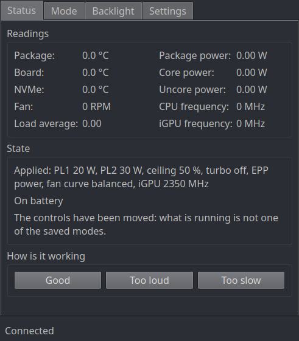
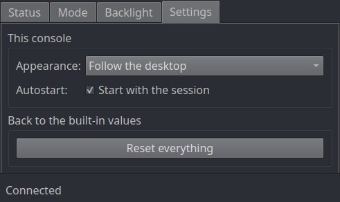

*English · [Русский](SCREENSHOTS.ru.md)*

# The interface

All of it belongs to `ombra-tray`. The daemon itself has no interface: it answers
on a socket and on three D-Bus names.

## The tray menu


The first line is the current mode with the package temperature and the fan
speed beside it, because that is what a glance at the panel is for. Below it the
modes as the daemon has them saved — the menu is built from a status reply, not
compiled in — then the console and the way out.

The icon says which mode is in force: a chip whose fill rises with the power
envelope, blue while the daemon answers, red while the emergency guard is
clamping, grey with a bar across it when nothing is answering.

It is drawn here rather than named from the icon theme, and that is the second
attempt. Publishing a standard name is the polite thing to do — the panel would
draw the glyph of the theme in force and recolour it to match itself — but a
StatusNotifierItem host prefers the name over any picture sent with it and draws
a placeholder for a name it cannot resolve. It resolves names in its own icon
theme and reaches nothing that theme does not carry, while Qt follows the same
theme's inheritance and finds `power-profile-*-symbolic` two themes further up.
So the check said yes and the panel drew an empty square.

Nor is there a glyph to borrow. The icon themes on this machine carry no trio
about power at all; what they have is trios about volume, screen brightness,
microphone sensitivity and security, and any of those would put a sun or a
speaker in the panel to mean a thermal envelope.

The colours are fixed for a related reason: the palette belongs to the
application, the panel is coloured by the desktop, and the two disagree exactly
when the desktop is light with a dark bar. The three used here read on both.

The console's colours are the desktop's own, and they follow it while the window
is open. On this machine `cosmic-settings-daemon` generates a Qt colour scheme
from the COSMIC theme and points `qt5ct` and `qt6ct` at it, so a Qt window starts
in the desktop's greys and accent without being told; when the desktop switches
theme it rewrites that file, and the console reads it again on the portal's
signal.

Reading the file is what makes an automatic switch at sunset reach a console that
has been open all day. Nothing else would: a platform theme does not update the
palette of a running application — measured on this machine, the file watcher is
there and the colours do not move — and reopening the window does not restart the
process, so the palette it was given at startup is the palette it keeps.

Where a desktop writes no such scheme, the portal's answer picks one of two
palettes of our own instead. The *Settings* tab can override the choice with
light or dark, and that applies at once; going back to following the desktop
hands the palette back, because Qt stops taking one from the platform theme once
an application has set its own.

The title bar is Qt's own on this desktop — the compositor offers to draw one and
Qt 6.4 does not ask it to — and it takes its colours when the window is created.
A change of scheme therefore reaches the widgets at once and the bar at the next
opening. Rebuilding the window to refresh the bar was tried and took the process
down with it, so the console leaves it alone: one close and one click on the
panel icon is the whole of it.

## The console

Four tabs: what only reports, the thermal mode, the backlight, and the console
itself. The split is by subject. Splitting by how long a change lasts instead —
the mode, the saved definitions, the live sliders — puts the same eight numbers
in three places, because "applies now" and "written down" are two properties of
one thing, not two things.

One line under the tabs carries both what the daemon's state is and what it said
to the last command, where every other window on the machine puts one. It is short
on purpose — "Connected", or the reply itself — and it never wraps: a command
echoed back with its assignments is longer than any sensible window, and a second
line would come out of the tab above. What does not fit is elided, and the whole
of it, along with the socket and the group, is in the tooltip: neither is something to go looking for on another tab, and
two lines meant a strip of empty space under every tab for as long as nothing had
been commanded yet. An accepted reply gives the line back after five seconds; a
refusal stays until the next command, because it is the answer to something the
person did and five seconds is not long enough to be sure it was read.

The pictures are taken in English whatever the language of the machine taking
them, and their file names come from the tabs' internal names rather than their
titles — a picture called `console-настройки.png` is a picture no document links
to.

### Status — what only reports



The readings in two columns — temperatures and the fan on one side, where the
power is going on the other — the indicators for the states worth knowing about,
and the three verdict buttons under *How is it working*: the question is whether
the machine is behaving, and two of the three answers are about noise and speed. The line under *State* here is an indicator doing its job: the
controls have been moved, so what is running is not one of the saved modes.

Good, too loud and too slow stamp a judgement onto the current sample. They are
on this tab because a judgement is about what the machine is doing right now,
and the readings that produced it are on screen beside them.

### Mode — one tab, in the order it is used


Pick a mode and the controls take its numbers. Move one and it applies at once,
and the mode selector empties — what is running is no longer any of the three,
and pretending otherwise would be a lie about the machine. *Save to* then writes
the controls into a mode you name, which is the only way any of this becomes
durable.

The selector follows the desktop panel as well: switching there moves the
controls here, so the panel and the console never disagree about what is
running.

Every number has a field beside its slider. A slider cannot be landed on a
particular value, and these values are compared between sessions and pasted into
notes.

The fan is one control with four answers: the three curves the firmware carries,
and full speed. Full speed is roughly 6100 RPM, and having it in the same list
is what makes "it is too hot right now" one click rather than a command line.

### Backlight — a separate function


Its own tab, deliberately not beside the mode: selecting a thermal mode never
moves the backlight, and nothing about the backlight reaches the thermal side.

Four sliders, all in per cent. *Brightness* is the ordinary control, and the
level it leaves behind is what the baseline is derived from; *Baseline* is that
level set outright, which is what to reach for when the light in the room is not
the light being tuned for; *Reaction to light* is how far the room may move the
backlight either way from it; *Never darker than* is the floor, which binds the
automation and a slip of the hand alike. There is no ceiling, because that is
100 %, and there are no profiles: one room, one set of settings.

The baseline is a control only while the automation is running. Switched off it
is a number nothing acts on, so it is greyed out rather than left to be moved.

Nothing about the sensor is on screen. What the room measures in lux is the
daemon's business, and the curve that reads it is calibrated from recorded
telemetry rather than judged on the spot.

Every control explains itself on hover, and so does every entry of every list:
what the long-term limit is against the short-term one, what `balance_power` means,
what a fan curve actually does at 3700 RPM, and — for each mode — its own numbers
and where it sits on the scale. A list of three names says nothing to somebody
seeing it for the first time, and the mode descriptions are built from the saved
definitions rather than written down, so a mode that is tuned takes its
description with it. Those explanations used to be paragraphs in the window, which
cost the controls height and doubled what there was to translate.

Everything that sends a command greys out while nothing is answering, on every
tab: a slider parked at its minimum is otherwise indistinguishable from a daemon
holding 1 W.

Each picture is fitted to its own tab. In use the window takes the size of its
largest tab and keeps it: every tab fits, so switching moves nothing, and the
frame does not resize — what dragging it could produce is either empty space or
a scrollbar over content that had room. A photograph of one size for all four
would carry a field of nothing under the short tabs, which is why the pictures
are the one place that size is undone.

### Settings — about the program rather than the machine



What this window looks like, whether it starts with the session, and the one
button that discards every setting there is.

*Appearance* is light, dark, or whatever the desktop says, kept in the console's
own settings file. *Start with the session* writes an XDG autostart entry and
nothing else — and the entry *is* the state, which is why something switched off
stays off with nothing to bring it back. It takes effect at the next login,
because the session reads autostart entries when it starts, and the window says
so rather than looking as though the click did nothing.

*Reset everything* is the way out of a mess: every mode definition and every
backlight setting back to the values compiled into the daemon. It asks first. It
is here rather than beside the numbers it discards because it covers all of
them, it is used about once, and on the mode tab it cost height the controls
above it needed.

## Making them again

```bash
make
./scripts/screenshots.sh
```

One command, all five files — the menu and one per tab — run from the
repository root.

The daemon it photographs is a throwaway one, started by that script against a
fake control surface: a directory of ordinary files built from the same header
the test suite uses. It therefore owns nothing and writes to nothing, and three
things follow. The readings are identical every time, so regenerating the
pictures is not a diff of somebody's afternoon temperatures. Nothing measured
on a real machine ends up in a public repository. And every command the console
asks about is answered, including the saved definitions, which an older
installed build would not know.

Nothing but the widget goes into the file either: these are grabs of our own
windows rather than of the screen, so no compositor and no screenshot tool is
involved and nothing else that happened to be on screen can end up here.

Before committing new pictures, look at them. The console names the socket path,
and from this script that is always `/tmp/ombra-screenshots/control.sock` — the
throwaway one. No host name, no user name and no path from a developer's home
belongs in this repository.

**A change to the interface is not finished until these are regenerated.** A
screenshot goes stale silently — no test catches it, and the reader is left
looking at controls that are no longer there.
