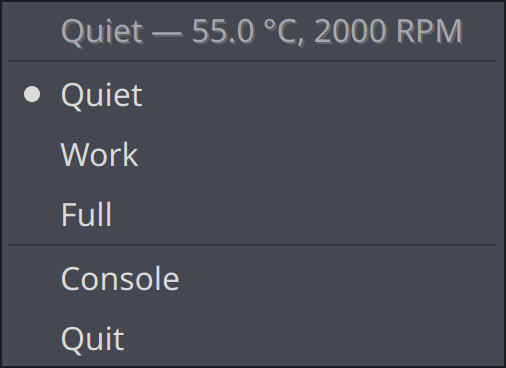
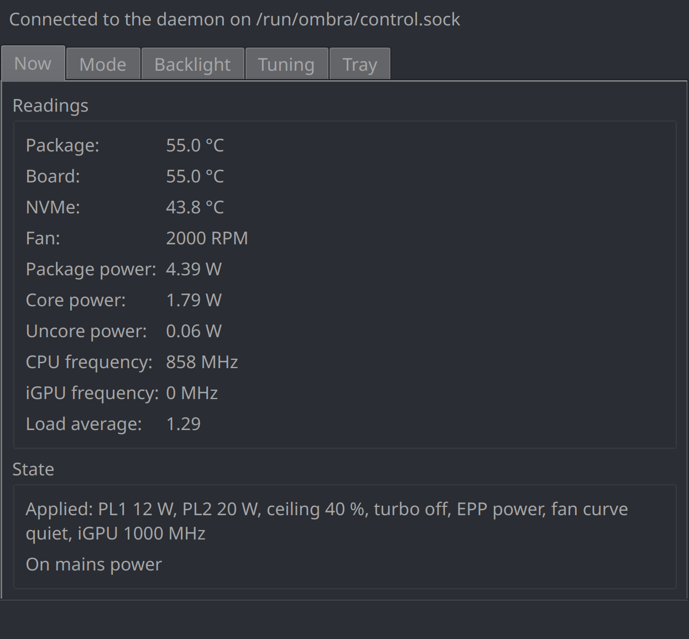
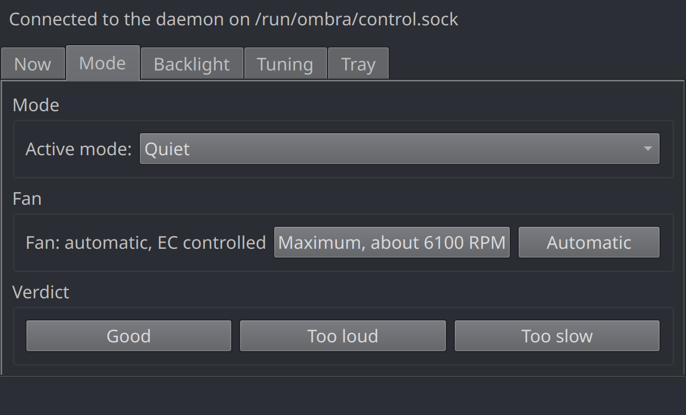
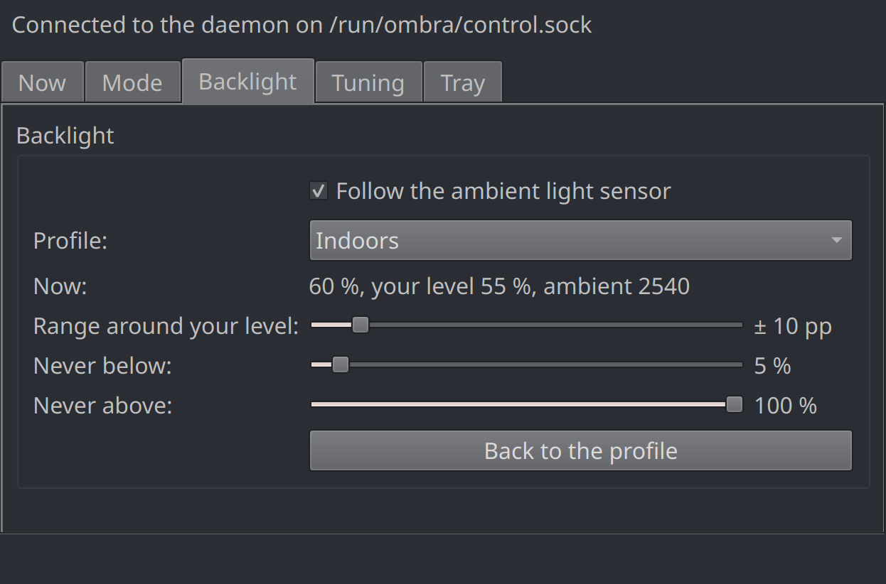
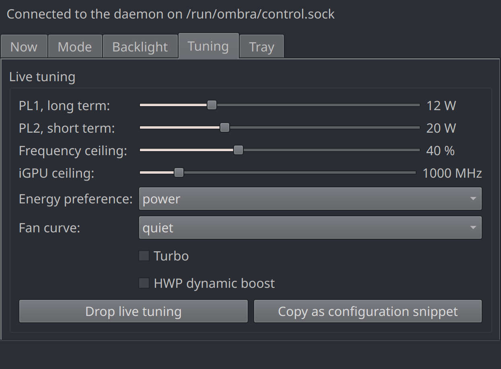
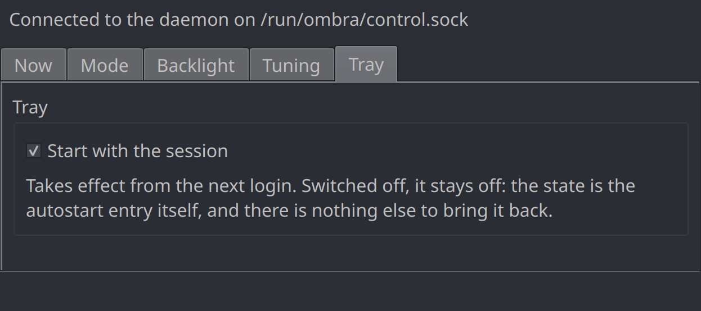

*English · [Русский](SCREENSHOTS.ru.md)*

# The interface

All of it belongs to `ombra-tray`. The daemon itself has no interface: it answers
on a socket and on three D-Bus names.

## The tray menu



The first line is the current mode with the package temperature and the fan
speed beside it, because that is what a glance at the panel is for. Below it the
modes as the configuration file defines them — the menu is built from a status
reply, not compiled in — then the console and the way out.

## The console

Five tabs. One column of every group is taller than a laptop screen, and a
window whose bottom is off screen hides the controls at the end of it.

The connection line and the reply line sit outside the tabs: whether the daemon
is answering, and what it said to the last command, are not things to go looking
for on another tab.

### Now — what only reports



The readings, and the indicators for the states worth knowing about. The two
lines under *State* here are those indicators doing their job rather than a
defect on display: live tuning is in force, so the setpoints shown are not the
mode's, and a control read back a value the daemon did not write — `thermald`
also writes RAPL and `intel_pstate` on this platform and is not something to
switch off, since it is a protection.

### Mode — the deliberate acts



Choosing an envelope, demanding maximum airflow, and recording what the result
sounds like. Maximum fan speed is roughly 6100 RPM and automatic control never
goes there; the verdict buttons stamp a judgement onto the current sample, so an
opinion stays traceable to the numbers that produced it.

### Backlight — a separate function



Its own tab, deliberately not beside the mode: selecting a thermal mode never
moves the backlight, and nothing about the backlight reaches the thermal side.
The three sliders are how far the automation may wander from the level you set
and the two absolute bounds. The curve is not here — its shape is calibrated
from recorded telemetry rather than judged on the spot.

### Tuning — by ear, right now



An experimentation console, not a settings dialog. Durable mode definitions live
in `/etc/ombra/modes.conf`; what this window does is the thing a file cannot —
every slider applies on the spot and is never written back anywhere, so a
setpoint can be judged by ear, or a brightness range by eye, while the numbers
that produced it are on screen beside it. When a value is worth keeping, *Copy as
configuration snippet* puts it on the clipboard as a section to paste, and
promoting it stays a deliberate edit.

Everything that sends a command greys out while nothing is answering, on every
tab: a slider parked at its minimum is otherwise indistinguishable from a daemon
holding 1 W.

Each picture is fitted to its own tab. In use the window opens at the size of
its largest tab and a tab taller than the screen scrolls, so a photograph of the
visible part would be missing whatever is below the fold.

### Tray — about the console itself



Whether the tray starts with the session. Everything else in this window is
about the machine; this is the one control that is about the console, and the one
thing the tray writes — an XDG autostart entry, which is not the daemon's
configuration and cannot reach a mode definition or a brightness profile.

The entry *is* the state: there is no settings file behind the switch, which is
why something switched off stays off with nothing to bring it back. It takes
effect at the next login, because the session reads autostart entries when it
starts, and the window says so rather than looking as though the click did
nothing.

## Making them again

```bash
ombra-tray --screenshot screenshots
```

One command, all six files — the menu and one per tab — run from the repository
root with the daemon running so
that the readings are real. Nothing but the widget goes into the file: these are
grabs of our own windows rather than of the screen, so no compositor and no
screenshot tool is involved and nothing else that happened to be on screen can
end up in a public repository.

Before committing new pictures, look at them: the console names the socket path
and the group, and neither should ever be anything but the packaged
`/run/ombra/control.sock` and `ombra`. No host name, no user name and no path
from a developer's machine belongs in this repository.

**A change to the interface is not finished until these are regenerated.** A
screenshot goes stale silently — no test catches it, and the reader is left
looking at controls that are no longer there.
