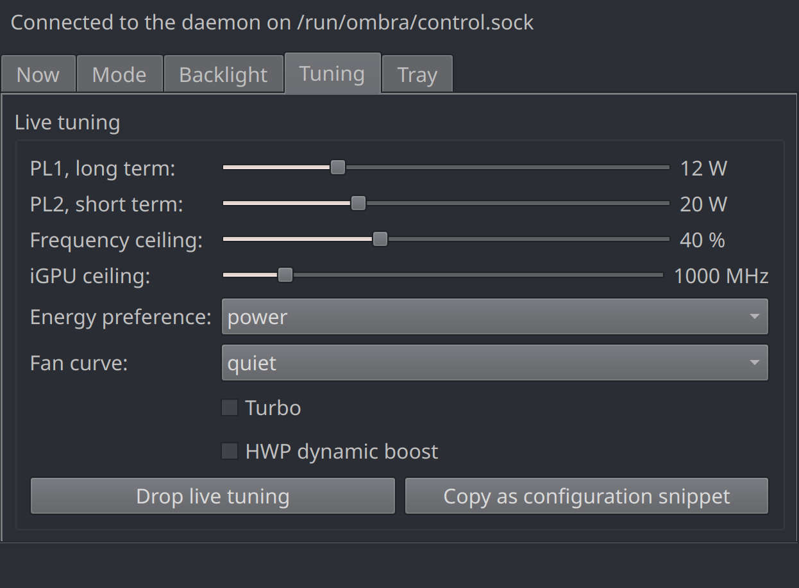

*[English](SCREENSHOTS.md) · Русский*

# Интерфейс

Весь он принадлежит `ombra-tray`. У самого демона интерфейса нет: он отвечает на
сокете и на трёх именах D-Bus.

## Меню трея


Первая строка — текущий режим, рядом температура пакета и обороты вентилятора:
именно за этим на панель и смотрят мельком. Ниже режимы в том виде, в каком их
задаёт файл конфигурации — меню строится из ответа `status`, а не вкомпилировано,
— затем консоль и выход.

## Консоль

Пять вкладок. Одна колонка из всех групп выше экрана ноутбука, а окно, у
которого низ за экраном, прячет то, что в этой колонке последнее.

Строка связи и строка ответа живут вне вкладок: отвечает ли демон и что он
сказал на последнюю команду — не то, за чем ходят на другую вкладку.

### Now — только показания


Показания и индикаторы состояний, о которых стоит знать. Две строки под *State*
здесь — это индикаторы за работой, а не выставленный напоказ дефект: живая
подгонка в силе, поэтому показанные уставки не принадлежат режиму, и один из
органов управления прочитался со значением, которое демон не писал — на этой
платформе в RAPL и `intel_pstate` пишет ещё и `thermald`, а отключать его нельзя,
это защита.

### Mode — осознанные действия


Выбор конверта, требование максимального обдува и запись того, как это звучит.
Максимум вентилятора — около 6100 RPM, автоматика туда не ходит никогда; кнопки
вердикта штампуют суждение на текущий сэмпл, чтобы мнение осталось привязанным к
числам, которые его вызвали.

### Backlight — отдельная функция


Своя вкладка, намеренно не рядом с режимом: выбор теплового режима никогда не
двигает подсветку, и ничто из подсветки не достаёт до тепловой части. Три
ползунка — насколько далеко автоматике позволено уходить от выставленного вами
уровня и две абсолютные границы. Кривой здесь нет: её форма калибруется по
записанной телеметрии, а не судится на месте.

### Tuning — на слух, здесь и сейчас



Пульт для экспериментов, а не диалог настроек. Долговечные определения режимов
живут в `/etc/ombra/modes.conf`; это окно делает то, чего файл не может: каждый
ползунок применяется на месте и никуда не записывается, так что уставку можно
судить на слух, а диапазон яркости — глазами, пока рядом на экране стоят числа,
которые её дали. Когда значение стоит сохранить, *Copy as configuration snippet*
кладёт его в буфер готовой секцией, а промотирование остаётся осознанной правкой.

Всё, что отправляет команды, гаснет, пока никто не отвечает, — на любой вкладке:
ползунок, стоящий на минимуме, иначе не отличить от демона, держащего 1 Вт.

Каждая картинка подогнана под свою вкладку. В работе окно открывается по размеру
самой большой вкладки, а вкладка выше экрана прокручивается, так что снимок
видимой части не содержал бы того, что ушло под сгиб.

### Tray — про саму консоль


Запускается ли трей вместе с сессией. Всё остальное в этом окне — про машину, а
это единственный орган управления про саму консоль и единственное, что трей
пишет: запись XDG-автозапуска, которая не является конфигурацией демона и не
достаёт ни до определения режима, ни до профиля яркости.

Запись *и есть* состояние: за галочкой нет файла настроек, поэтому выключенное
остаётся выключенным и вернуть его некому. Действует со следующего входа, потому
что записи автозапуска сессия читает при старте, — и окно об этом говорит, а не
делает вид, что нажатие ничего не дало.

## Как сделать их снова

```bash
ombra-tray --screenshot screenshots
```

Одна команда, все шесть файлов — меню и по одному на вкладку, — из корня
репозитория и с запущенным демоном, чтобы
показания были настоящими. В файл не попадает ничего, кроме виджета: это снимки
наших собственных окон, а не экрана, поэтому ни компоновщик, ни утилита снятия
экрана не участвуют и ничто постороннее с экрана не может оказаться в публичном
репозитории.

Перед коммитом новых картинок надо на них посмотреть: консоль называет путь
сокета и группу, и это всегда должны быть пакетные `/run/ombra/control.sock` и
`ombra`. Ни имени машины, ни имени пользователя, ни путей с машины разработчика
в этом репозитории быть не должно.

**Правка интерфейса не закончена, пока снимки не сделаны заново.** Снимок
устаревает молча — ни один тест этого не поймает, а читатель остаётся смотреть на
органы управления, которых больше нет.
