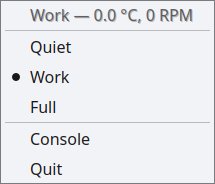
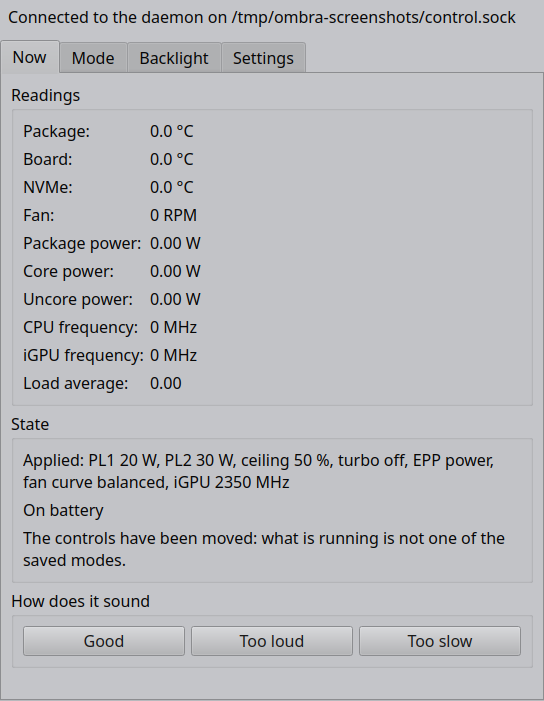
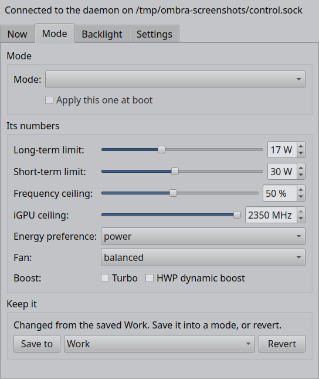
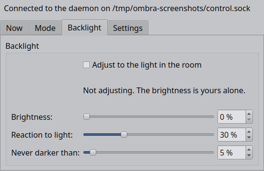
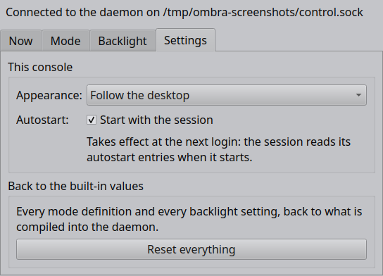

*[English](SCREENSHOTS.md) · Русский*

# Интерфейс

Весь он принадлежит `ombra-tray`. У самого демона интерфейса нет: он отвечает на
сокете и на трёх именах D-Bus.

## Меню трея



Первая строка — текущий режим, рядом температура пакета и обороты вентилятора:
именно за этим на панель и смотрят мельком. Ниже режимы в том виде, в каком их
хранит демон — меню строится из ответа `status`, а не вкомпилировано, — затем
консоль и выход.

Значок показывает, какой режим включён, и берёт для этого имена, которыми
пользуются панельные аплеты профилей питания: `power-profile-power-saver-symbolic`
для самого холодного, `-balanced-` для рабочего, `-performance-` для самого
свободного. Плюс два имени, которые режимами не являются:
`action-unavailable-symbolic`, когда демон не отвечает, и
`dialog-warning-symbolic`, когда зажал аварийный клапан. Имя, а не картинка:
тогда панель рисует значок из той темы иконок, которая включена, перекрашивает
его под себя и следует смене темы.

Подвох, из-за которого здесь вообще есть код: хост StatusNotifierItem
предпочитает имя картинке, присланной вместе с ним, поэтому имя, которого в его
теме нет, превращается в панели в вопросительный знак. Значит, имя публикуется
только если тема его знает, а иначе значок — наша картинка: чип, заливка
которого говорит, какой режим работает, нарисованный фиксированными цветами,
читаемыми и на светлой панели, и на тёмной. Палитра для этого не спрашивается:
палитра принадлежит приложению, панель раскрашивает среда, и расходятся они
ровно в случае «светлая тема среды, тёмный бар».

Чтобы проверка что-то значила, Qt должен искать имена в той теме, которой
пользуется панель. По умолчанию это не так — тема платформы называет свою
собственную, — поэтому консоль читает тему иконок среды у портала
(`org.gnome.desktop.interface` / `icon-theme`) и указывает её Qt. Смена темы
приходит сигналом портала, и значок выбирается заново.

Светлый или тёмный вид самой консоли — выбор на вкладке *Settings*: следовать
среде, светлый или тёмный. «Следовать среде» читает портал
`org.freedesktop.appearance`, а не Qt: `QStyleHints::colorScheme()` появился в
Qt 6.5, здесь Qt 6.4, а тема платформы берёт цвета из собственного конфига и на
среду не смотрит вовсе. Своя палитра применяется, только если текущая — другой
светлоты, то есть на настроенной как надо среде не применяется никогда. До
значка в панели всё это не достаёт: что рисовать там, решает среда.

## Консоль

Четыре вкладки: то, что только показывает, тепловой режим, подсветка и сама
консоль. Деление идёт по предмету. Разделить иначе — режим, сохранённые
определения, живые ползунки — значит выложить одни и те же восемь чисел в трёх
местах, потому что «применяется сейчас» и «записано» суть два свойства одной
вещи, а не две вещи.

Строка связи живёт вне вкладок: отвечает ли демон — не то, за чем ходят на
другую вкладку. Ответ демона на последнюю команду появляется под ними на тех же
условиях — и только когда он есть: строка ответа, висящая с самого начала, это
полоса пустоты вдоль низа каждой вкладки.

### Now — только показания



Показания, индикаторы состояний, о которых стоит знать, и три кнопки вердикта.
Строка под *State* здесь — индикатор за работой: ползунки двигали, поэтому
работает не один из сохранённых режимов.

«Хорошо», «шумно» и «медленно» ставят суждение в текущую выборку. Они на этой
вкладке потому, что суждение — про то, что машина делает прямо сейчас, а
породившие его показания стоят рядом.

### Mode — одна вкладка, в порядке употребления



Выбираешь режим — ползунки берут его числа. Двигаешь ползунок — он применяется
сразу, а список режимов пустеет: работает уже не один из трёх, и утверждать
обратное значило бы врать про машину. Кнопка *Save to* потом записывает ползунки
в режим, который ты назовёшь, и это единственный способ сделать всё это
долговременным.

Список следит и за панелью десктопа: переключение там двигает ползунки здесь,
так что панель и консоль никогда не расходятся в том, что работает.

У каждого числа рядом с ползунком есть поле. На ползунке нельзя попасть в
конкретное значение, а эти значения сравнивают между сессиями и вставляют в
заметки.

Вентилятор — один список с четырьмя ответами: три кривые, которые несёт
прошивка, и полная скорость. Полная — это примерно 6100 об/мин, и то, что она в
том же списке, превращает «сейчас слишком горячо» в один щелчок вместо команды в
терминале.

### Backlight — отдельная функция



Своя вкладка, намеренно не рядом с режимом: выбор теплового режима никогда не
двигает подсветку, и ничто из подсветки не достаёт до тепловой части.

Три ползунка, все в процентах. *Brightness* — обычная яркость, и оставленный ею
уровень становится базой, вокруг которой работает всё остальное; *Reaction to
light* — насколько далеко комната вправе его двигать в обе стороны; *Never darker
than* — пол, который держит и автоматику, и сорвавшуюся руку. Потолка нет,
потому что потолок — это 100%, и профилей нет: комната одна, набор настроек
один.

Про датчик на экране нет ничего. Сколько люксов в комнате — забота демона, а
кривая, которая эти люксы читает, калибруется по записанной телеметрии, а не
судится на месте.

Всё, что шлёт команды, гаснет, пока никто не отвечает, и так на каждой вкладке:
ползунок, стоящий на минимуме, иначе неотличим от демона, который держит 1 Вт.

Каждая картинка подогнана под свою вкладку. В работе окно берёт размер самой
большой вкладки и держит его: помещаются все, поэтому переключение ничего не
двигает, а рамка не тянется — тянуть её можно было бы разве что ради пустого
места или полосы прокрутки над содержимым, которому места хватало. Снимок одного
размера на все четыре нёс бы поле пустоты под короткими вкладками, и потому
картинки — единственное место, где этот размер отменяется.

### Settings — про программу, а не про машину



Как выглядит это окно, запускается ли оно вместе с сессией, и одна кнопка,
которая выбрасывает все настройки, какие есть.

*Appearance* — светлый, тёмный или как в среде; выбор лежит в собственном файле
настроек консоли. *Start with the session* пишет запись XDG-автозапуска и больше
ничего, и эта запись *и есть* состояние: поэтому выключенное остаётся
выключенным и вернуть его некому. Действует со следующего входа, потому что
записи автозапуска сессия читает при старте, — и окно об этом говорит, а не
выглядит так, будто щелчок ничего не сделал.

*Reset everything* — выход из бардака: все определения режимов и все настройки
подсветки назад к значениям, вшитым в демон. Кнопка сначала спрашивает. Она
здесь, а не рядом с числами, которые выбрасывает: она накрывает их все,
нажимается примерно один раз, а на вкладке режима отнимала высоту, которая нужна
была ползункам выше.

## Как сделать их снова

```bash
make
./scripts/screenshots.sh
```

Одна команда, все пять файлов — меню и по одному на вкладку, — из корня
репозитория.

Снимается при этом одноразовый демон, которого поднимает сам скрипт поверх
поддельной поверхности управления: каталога обычных файлов, собранного из того
же заголовка, что использует набор тестов. Он ничем не владеет и никуда не
пишет, и отсюда следует три вещи. Показания одинаковы от раза к разу, поэтому
пересъёмка перестаёт быть дифом чьих-то дневных температур. Ничто измеренное на
настоящей машине не попадает в публичный репозиторий. И отвечает он на все
команды, которые задаёт консоль, включая сохранённые определения, — чего
установленная сборка постарше не умела бы.

Кроме виджета, в файл тоже не попадает ничего: это снимки наших собственных
окон, а не экрана, поэтому ни компоновщик, ни утилита снятия экрана не
участвуют и ничто постороннее с экрана здесь оказаться не может.

Перед коммитом новых картинок надо на них посмотреть. Консоль называет путь
сокета, и из этого скрипта это всегда `/tmp/ombra-screenshots/control.sock` —
одноразовый. Ни имени машины, ни имени пользователя, ни путей из домашнего
каталога разработчика в этом репозитории быть не должно.

**Правка интерфейса не закончена, пока снимки не сделаны заново.** Снимок
устаревает молча — ни один тест этого не поймает, а читатель остаётся смотреть на
органы управления, которых больше нет.
