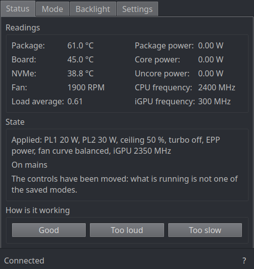
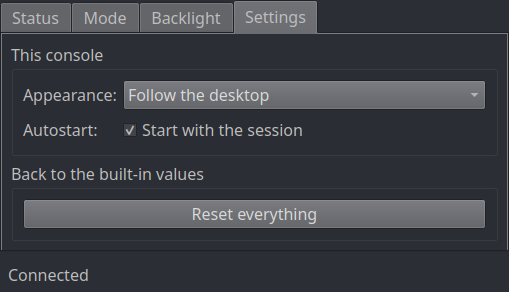

*[English](SCREENSHOTS.md) · [Русский](SCREENSHOTS.ru.md) · Español*

# La interfaz

Toda ella pertenece a `sombra-tray`. El demonio no tiene interfaz: responde en un
socket y en tres nombres de D-Bus.

Aquí se dice qué muestra cada imagen y qué revisar antes de subir una nueva. Por
qué la interfaz es así está en [DESIGN.es.md](DESIGN.es.md); el icono del panel se
describe allí también, porque vive en el panel y no aparece en ninguna de estas
capturas.

## El menú de la bandeja


El modo actual con la temperatura del paquete y las revoluciones del ventilador al
lado, después los modos tal como los guarda el demonio — el menú se construye a
partir de una respuesta de estado y no viene compilado — y por último la consola y
la salida. La misma línea está en la ayuda emergente, junto con un control
sobrescrito por otro proceso y los sensores que no se pudieron leer.

## La consola

Cuatro pestañas, separadas por tema: lo que solo informa, el modo térmico, la
retroiluminación y el programa mismo.

### Estado — lo que solo informa



Las lecturas en dos columnas, las temperaturas y el ventilador a un lado y a dónde
va la potencia al otro, después los indicadores de los estados que conviene
conocer, y por último los tres botones de veredicto que estampan un juicio sobre
la muestra actual. La línea bajo *Estado* en esta imagen es un indicador haciendo
su trabajo: los controles se han movido, así que lo que está en marcha no es
ninguno de los modos guardados.

### Modo — una sola pestaña, en el orden en que se usa


Se elige un modo y los controles toman sus números. Se mueve uno y se aplica al
instante, y el selector de modo se vacía, porque lo que está en marcha ya no es
ninguno de los tres. *Guardar en* escribe los controles en un modo que tú nombras.
El ventilador es un solo control con cuatro respuestas: las tres curvas que trae el
firmware y las revoluciones máximas.

### Retroiluminación — una función aparte


Cinco deslizadores, todos en por ciento: el brillo de siempre, la referencia
desde la que trabaja la automatización, cuánto puede la luz de la habitación mover
la retroiluminación en cada sentido, y el suelo y el techo, que sujetan tanto a la
automatización como a un resbalón de la mano. La referencia está atenuada aquí
porque la automatización está apagada, y entonces es un número sobre el que nadie
actúa.

### Ajustes — sobre el programa, no sobre la máquina



Qué aspecto tiene la ventana, si arranca con la sesión, y el único botón que
descarta todos los ajustes que hay.

## Cómo volver a hacerlas

```bash
make
./scripts/screenshots.sh
```

Un solo comando, los cinco archivos — el menú y uno por pestaña — desde la raíz del
repositorio.

El demonio al que fotografía es de un solo uso: el guion lo levanta sobre una
superficie de control falsa, un directorio de archivos ordinarios construido a
partir de la misma cabecera que usa el conjunto de pruebas. De ahí tres
consecuencias: las lecturas son idénticas cada vez, nada medido en una máquina real
llega a un repositorio público, y toda orden que la consola hace tiene respuesta,
incluidas las definiciones guardadas que una versión instalada más antigua no
conocería. Se capturan nuestros propios widgets y no la pantalla, así que nada de
lo que hubiera a la vista puede acabar aquí.

Las imágenes se toman en inglés sea cual sea el idioma de la máquina que las toma, y
sus nombres de archivo vienen de los nombres internos de las pestañas y no de sus
títulos: a un archivo llamado `console-ajustes.png` no lo enlaza ningún documento.
Cada imagen está ajustada a su propia pestaña, mientras que la ventana en uso
mantiene el tamaño de la mayor: un solo tamaño para las cuatro llevaría un campo de
nada debajo de las pestañas cortas.

Antes de subir imágenes nuevas, míralas. La consola nombra la ruta del socket, y
desde este guion siempre es `/tmp/sombra-screenshots/control.sock`, la de un solo
uso. Ni el nombre de la máquina, ni el del usuario, ni una ruta del directorio
personal de nadie tienen sitio en este repositorio.

**Un cambio en la interfaz no está terminado hasta que estas imágenes se vuelven a
generar.** Una captura envejece en silencio: ninguna prueba lo detecta, y quien lee
se queda mirando controles que ya no existen.
