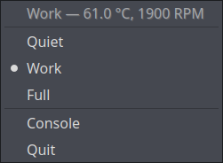
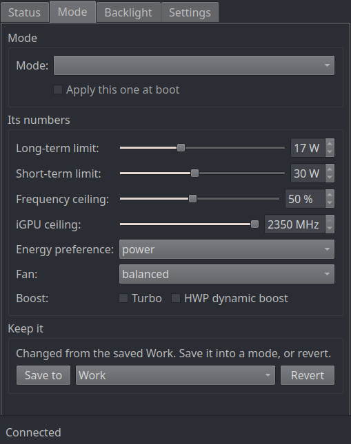
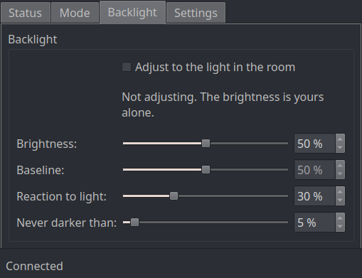

*[English](SCREENSHOTS.md) · [Русский](SCREENSHOTS.ru.md) · Español*

# La interfaz

Toda ella pertenece a `sombra-tray`. El demonio en sí no tiene interfaz:
responde en un socket y en tres nombres de D-Bus.

## El menú de la bandeja



La primera línea es el modo actual, con la temperatura del paquete y las
revoluciones del ventilador al lado, que es para lo que se mira el panel de
reojo. Debajo, los modos tal como los guarda el demonio, porque el menú se
construye a partir de una respuesta de estado y no viene compilado, y después la
consola y la salida.

El icono es la imagen propia de la aplicación, un sol detrás de una persiana, y
responde a tres cosas. La persiana dice qué modo está en vigor: cerrada en el
margen más frío, abierta en el más amplio. El sol dice si el demonio responde:
cálido, o gris y entonces sin persiana alguna. La placa se pone roja mientras
aprieta la protección de emergencia. Otras dos condiciones no caben como un
cuarto canal en una imagen de este tamaño: un control sobrescrito por otro
proceso y sensores que no se pudieron leer. Las nombra la ayuda emergente, junto
con el modo, la temperatura y las revoluciones del ventilador.

El panel muestra tres lamas donde el icono de la aplicación muestra cinco. A 22
píxeles, cinco lamas dan un paso de menos de dos píxeles y el extremo cerrado
del recorrido se funde en un solo bloque oscuro, y ahí el modo deja de ser
legible en el único tamaño que importa.

Aquí se dibuja en lugar de pedirlo por nombre al tema de iconos. Publicar un
nombre estándar es lo cortés, porque el panel dibujaría el glifo del tema en
vigor y lo recolorearía a su gusto, pero un anfitrión StatusNotifierItem
prefiere el nombre a cualquier imagen que venga con él y dibuja un marcador de
posición cuando no logra resolverlo. Los nombres los resuelve en su propio tema
de iconos y no alcanza nada que ese tema no traiga, mientras que Qt sigue la
herencia de ese mismo tema y encuentra `power-profile-*-symbolic` dos temas más
arriba. La comprobación decía que sí y el panel dibujaba un cuadrado vacío.

Tampoco hay ningún glifo que tomar prestado. Los temas de iconos de esta máquina
no traen ningún trío sobre potencia: tienen tríos sobre volumen, brillo de
pantalla, sensibilidad del micrófono y seguridad, y cualquiera de ellos pondría
un sol a secas o un altavoz en el panel para hablar del margen térmico. El sol de
aquí está detrás de una persiana, y en eso está toda la diferencia.

Los colores están fijados por una razón parecida: la paleta pertenece a la
aplicación, el panel lo colorea el escritorio, y los dos discrepan justo cuando
el escritorio es claro y la barra oscura. La imagen lleva su propia placa para
que solo un contraste tenga que ver con el escritorio. Un sol cálido como glifo
plano mide 1.5:1 contra un panel claro, donde el mínimo es 3.5, y la placa lo
supera en sus dos colores.

Los colores de la consola son los del escritorio, y la siguen mientras la
ventana está abierta. En esta máquina `cosmic-settings-daemon` genera un esquema
de color de Qt a partir del tema COSMIC y apunta `qt5ct` y `qt6ct` hacia él, así
que una ventana de Qt arranca con los grises y el acento del escritorio sin que
nadie se lo diga; cuando el escritorio cambia de tema reescribe ese archivo, y
la consola lo vuelve a leer con la señal del portal.

Leer el archivo es lo que hace que un cambio automático al atardecer llegue a
una consola que lleva todo el día abierta. Nada más llegaría: el tema de la
plataforma no actualiza la paleta de una aplicación en marcha (medido en esta
máquina, el vigilante de archivos está y los colores no se mueven), y volver a
abrir la ventana no reinicia el proceso, así que la paleta se queda en la que
recibió al arrancar.

Donde el escritorio no escribe ningún esquema así, la respuesta del portal elige
entre dos paletas propias. La pestaña *Ajustes* permite imponer claro u oscuro,
y eso surte efecto al instante; volver a seguir al escritorio devuelve la
paleta, porque Qt deja de tomarla del tema de la plataforma en cuanto la
aplicación ha fijado la suya.

En este escritorio la barra de título la dibuja Qt, ya que el compositor ofrece
dibujarla y Qt 6.4 no se lo pide, y toma sus colores en el momento en que se
crea la ventana. Un cambio de esquema llega por tanto a los widgets al instante
y a la barra en la siguiente apertura. Reconstruir la ventana para refrescar la
barra se probó, y se llevó el proceso por delante, así que la consola no la
toca: cerrar y volver a hacer clic en el icono del panel, y ya está.

## La consola

Cuatro pestañas: lo que solo informa, el modo térmico, la retroiluminación y la
consola misma. La división es por tema. Dividirlas en cambio según lo que dura
cada ajuste (el modo, las definiciones guardadas, los controles deslizantes en
vivo) deja los mismos ocho valores en tres sitios, porque «se aplica ahora» y
«queda escrito» son dos propiedades de una misma cosa, no dos cosas.

Una sola línea bajo las pestañas lleva el estado del demonio y también lo que
respondió a la última orden, en el sitio donde la ponen todas las demás ventanas
de la máquina. Es corta a propósito, «Conectado» o la respuesta misma, y nunca
se parte en dos: una orden devuelta con sus asignaciones es más larga que
cualquier ventana razonable, y una segunda línea saldría del espacio de la
pestaña de encima. Lo que no cabe se recorta, y el texto completo, junto con el
socket y el grupo, está en la información al pasar el ratón: ninguno de los dos
es algo que uno vaya a buscar en otra pestaña, y dos líneas suponían una franja
de vacío bajo cada pestaña hasta que se diera la primera orden. Una respuesta
aceptada devuelve la línea a los cinco segundos; un rechazo se queda hasta la
orden siguiente, porque es la respuesta a algo que hizo la persona y cinco
segundos no bastan para estar seguro de que se ha leído.

Las capturas se hacen en inglés, sea cual sea el idioma de la máquina que las
toma, y los nombres de archivo salen de los nombres internos de las pestañas y
no de sus títulos: una imagen llamada `console-ajustes.png` es una imagen a la
que no apunta ningún documento.

### Estado — lo que solo informa


Las lecturas en dos columnas, las temperaturas y el ventilador a un lado y a
dónde va la potencia al otro; los indicadores de los estados que conviene
conocer; y los tres botones de veredicto bajo *Cómo funciona*: la pregunta es si
la máquina se está portando bien, y dos de las tres respuestas hablan de ruido y
de velocidad. La línea bajo *Estado* es aquí un indicador haciendo su trabajo:
los controles se han movido, así que lo que está en marcha no es ninguno de los
modos guardados.

«Bien», «demasiado ruidoso» y «demasiado lento» marcan un juicio sobre la
muestra actual. Están en esta pestaña porque el juicio va sobre lo que la
máquina hace ahora mismo, y las lecturas que lo han provocado están al lado, en
la pantalla.

### Modo — una sola pestaña, en el orden en que se usa



Al elegir un modo, los controles toman sus valores. Al mover uno, se aplica al
instante y el selector de modo se queda vacío: lo que está en marcha ya no es
ninguno de los tres, y decir lo contrario sería mentir sobre la máquina.
*Guardar en* escribe después los controles en el modo que se le indique, y es la
única forma de que algo de esto quede fijado.

El selector sigue también al panel del escritorio: cambiar allí mueve los
controles de aquí, así que el panel y la consola nunca discrepan sobre lo que
está en marcha.

Cada valor tiene un campo al lado de su control deslizante. Con un deslizante no
se acierta un valor concreto, y estos valores se comparan entre sesiones y se
pegan en notas.

El ventilador es un único control con cuatro respuestas: las tres curvas que
trae el firmware y la velocidad máxima. La máxima ronda las 6100 RPM, y tenerla
en la misma lista convierte «ahora mismo hace demasiado calor» en un clic en
lugar de una orden en la terminal.

### Retroiluminación — una función aparte



Pestaña propia, a propósito lejos del modo: elegir un modo térmico nunca mueve
la retroiluminación, y nada de la retroiluminación alcanza el lado térmico.

Cuatro controles deslizantes, todos en por ciento. *Brillo* es el control de
siempre, y del nivel en que queda se deriva la base; *Base* es ese mismo
nivel fijado directamente, y es lo que hay que usar cuando la luz de la
habitación no es la luz para la que se está ajustando; *Reacción a la luz* es
cuánto puede la habitación mover la retroiluminación hacia arriba o hacia abajo
desde la base; *Nunca más oscuro que* es el suelo, y ata igual a la
automatización que a un resbalón de la mano. Techo no hay, porque el techo es el
100 %, y perfiles tampoco: una habitación, un juego de ajustes.

La base es un control solo mientras la automatización está en marcha. Apagada,
es un valor al que nada reacciona, así que se atenúa en vez de quedarse a mano
para que alguien lo mueva.

Del sensor no hay nada en la pantalla. Cuántos lux hay en la habitación es
asunto del demonio, y la curva que los lee se calibra con telemetría grabada, no
a ojo en el momento.

Cada control se explica al pasar el ratón, y cada entrada de cada lista también:
en qué se diferencia el límite prolongado del breve, qué significa
`balance_power`, qué hace de verdad una curva del ventilador a 3700 RPM y, para
cada modo, sus valores y su sitio en la escala. Una lista de tres nombres no
dice nada a quien la ve por primera vez, y las descripciones de los modos se
construyen con las definiciones guardadas en vez de estar escritas a mano, así
que un modo ajustado se lleva su descripción consigo. Esas mismas explicaciones
como párrafos en la ventana le quitarían altura a los controles y duplicarían lo
que hay que traducir.

Todo lo que envía una orden se atenúa mientras no responde nadie, en todas las
pestañas: un deslizante parado en su mínimo es, si no, indistinguible de un
demonio que mantiene 1 W.

Cada imagen está ajustada a su propia pestaña. En uso, la ventana toma el tamaño
de su pestaña más grande y lo mantiene: caben todas, así que cambiar de pestaña
no mueve nada, y el marco no se redimensiona, porque arrastrarlo solo daría
espacio vacío o una barra de desplazamiento sobre un contenido al que le sobraba
sitio. Una sola imagen del mismo tamaño para las cuatro llevaría un campo de
nada bajo las pestañas cortas, y por eso las imágenes son el único lugar donde
ese tamaño se deshace.

### Ajustes — sobre el programa, no sobre la máquina


El aspecto de esta ventana, si arranca con la sesión, y el único botón que
descarta todos los ajustes que hay.

*Apariencia* es claro, oscuro o lo que diga el escritorio, y la elección vive en
el archivo de ajustes de la propia consola. *Iniciar con la sesión* escribe una
entrada de autoarranque XDG y nada más, y esa entrada *es* el estado: por eso lo
que se apaga sigue apagado y no hay nada que lo devuelva. Surte efecto en el
próximo inicio de sesión, porque la sesión lee las entradas de autoarranque al
arrancar, y la ventana lo dice en vez de parecer que el clic no ha hecho nada.

*Restablecer todo* es la salida del desorden: cada definición de modo y cada
ajuste de retroiluminación vuelven a los valores compilados en el demonio.
Pregunta antes. Está aquí y no al lado de los valores que descarta porque los
cubre todos, se usa una sola vez y poco más, y en la pestaña del modo le quitaba
altura que necesitaban los controles de encima.

## Cómo volver a hacerlas

```bash
make
./scripts/screenshots.sh
```

Una sola orden, los cinco archivos (el menú y uno por pestaña), desde la raíz
del repositorio.

El demonio al que se retrata es de un solo uso: lo levanta ese mismo script
sobre una superficie de control falsa, un directorio de archivos corrientes
construido con la misma cabecera que usa el conjunto de pruebas. No es dueño de
nada ni escribe en ningún sitio, y de ahí salen tres cosas. Las lecturas son
idénticas cada vez, así que volver a generar las imágenes no es un diff de las
temperaturas de la tarde de alguien. Nada medido en una máquina real acaba en un
repositorio público. Y contesta a todas las órdenes que le manda la consola,
incluidas las definiciones guardadas, que una compilación instalada más antigua
no conocería.

Al archivo tampoco entra nada aparte del widget: son capturas de nuestras
propias ventanas y no de la pantalla, así que no participa ningún compositor ni
ninguna herramienta de captura, y nada ajeno que estuviera en pantalla puede
acabar aquí.

Antes de hacer commit de las imágenes nuevas hay que mirarlas. La consola
muestra la ruta del socket, y desde este script es siempre
`/tmp/sombra-screenshots/control.sock`, la del demonio de un solo uso. En este
repositorio no cabe ningún nombre de máquina, ningún nombre de usuario ni
ninguna ruta del directorio personal de un desarrollador.

**Un cambio en la interfaz no está terminado hasta que estas imágenes se
rehacen.** Una captura queda obsoleta en silencio: ninguna prueba lo detecta, y
el lector se queda mirando controles que ya no existen.
