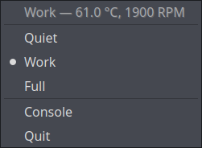
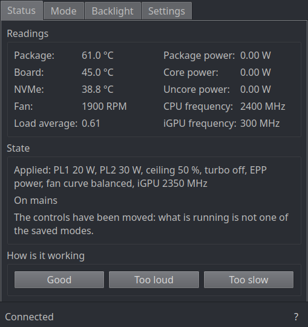
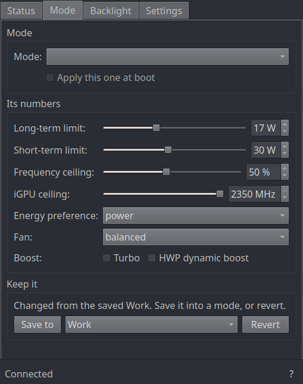
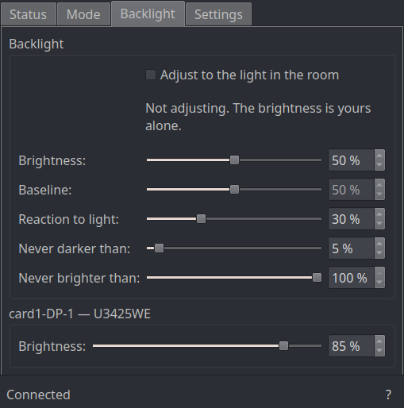
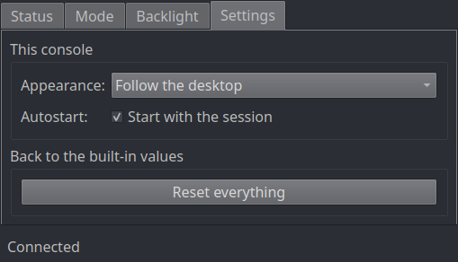

*English · [Русский](SCREENSHOTS.ru.md) · [Español](SCREENSHOTS.es.md)*

# The interface

All of it belongs to `sombra-tray`. The daemon itself has no interface: it answers
on a socket and on three D-Bus names.

This document says what each picture shows and what to check before committing a
new one. Why the interface is built this way is in [DESIGN.md](DESIGN.md); the
panel icon is described there too, because it is in the panel and in none of these
grabs.

## The tray menu



The current mode with the package temperature and the fan speed beside it, then
the modes as the daemon has them saved — the menu is built from a status reply,
not compiled in — then the console and the way out. The tooltip carries the same
line, along with a control overwritten by another process and sensors that could
not be read.

## The console

Four tabs, split by subject: what only reports, the thermal mode, the backlight,
and the program itself.

### Status — what only reports



The readings in two columns, temperatures and the fan on one side and where the
power is going on the other, then the indicators for the states worth knowing
about, then the three verdict buttons that stamp a judgement onto the current
sample. The line under *State* in this picture is an indicator doing its job: the
controls have been moved, so what is running is not one of the saved modes.

### Mode — one tab, in the order it is used



Pick a mode and the controls take its numbers. Move one and it applies at once and
the selector empties, because what is running is then no longer any of the three.
*Save to* writes the controls into a mode you name. The fan is one control with
four answers: the three curves the firmware carries, and full speed.

### Backlight — a separate function



Five sliders, all in per cent: the ordinary brightness control, the baseline the
automation works from, how far the room may move the backlight either way, and the
floor and the ceiling, which bind the automation and a slip of the hand alike. The
baseline is greyed out here because the automation is off, and then it is a number
nothing acts on.

At the end of the status line there is a `?`. It opens the reference — every control
of every tab with its units, its range and what it costs, in the language the window
is speaking — at the section of the tab it was pressed on. Outside the window, because a page has no room in one whose height is
the height of its largest tab.

Below the panel's own controls there is a group for each external monitor that
answers DDC/CI, titled by its socket and its model — the socket because a model is
not always a name, and two identical titles would be two sliders nobody can tell
apart. Its slider is sent when it is let go rather than while it moves: a write over
that bus is about 300 ms. A monitor that stops answering keeps its position and
greys out.

### Settings — about the program rather than the machine



What the window looks like, whether it starts with the session, how much telemetry
is kept and whether any is recorded at all, and the one button that discards every
setting there is. The two telemetry controls are the daemon's settings rather than
the console's, which is what they have in common with the reset beside them.

## Making them again

```bash
make
./scripts/screenshots.sh
```

One command, all five files — the menu and one per tab — run from the repository
root.

The daemon it photographs is a throwaway one, started by that script against a
fake control surface: a directory of ordinary files built from the same header the
test suite uses. So the readings are identical every time, nothing measured on a
real machine ends up in a public repository, and every command the console asks
about is answered, including the saved definitions an older installed build would
not know. The grabs are of our own widgets rather than of the screen, so nothing
else that happened to be on screen can end up in them.

The pictures are taken in English whatever the language of the machine taking
them, and their file names come from the tabs' internal names rather than their
titles — a picture called `console-настройки.png` is a picture no document links
to. Each one is fitted to its own tab, where the window in use keeps the size of
its largest: one size for all four would carry a field of nothing under the short
tabs.

Before committing new pictures, look at them. The console names the socket path,
and from this script that is always `/tmp/sombra-screenshots/control.sock` — the
throwaway one. No host name, no user name and no path from a developer's home
belongs in this repository.

**A change to the interface is not finished until these are regenerated.** A
screenshot goes stale silently — no test catches it, and the reader is left
looking at controls that are no longer there.
