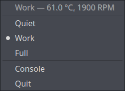
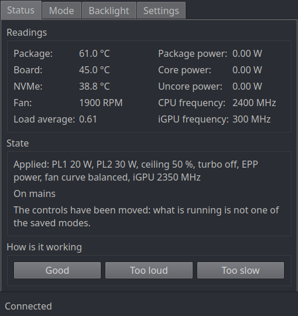
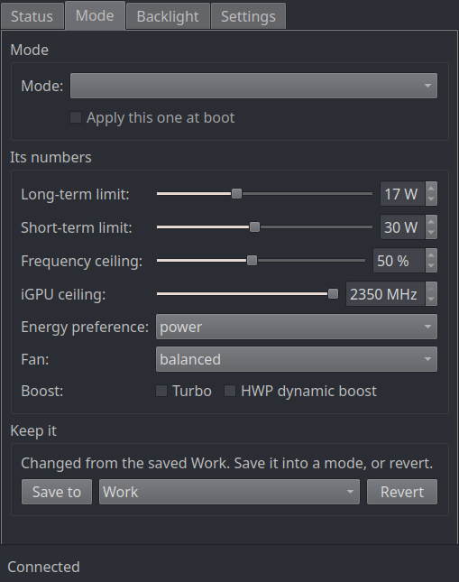
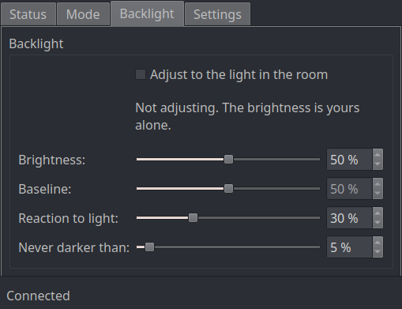
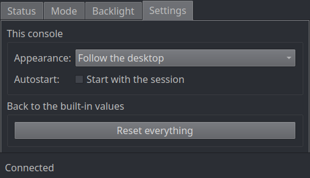

*[English](SCREENSHOTS.md) · Русский · [Español](SCREENSHOTS.es.md)*

# Интерфейс

Весь он принадлежит `sombra-tray`. У самого демона интерфейса нет: он отвечает на
сокете и на трёх именах D-Bus.

## Меню трея



Первая строка — текущий режим, рядом температура пакета и обороты вентилятора:
именно за этим на панель и смотрят мельком. Ниже режимы в том виде, в каком их
хранит демон — меню строится из ответа `status`, а не вкомпилировано, — затем
консоль и выход.

Значок — собственная картинка приложения, солнце за жалюзи, и отвечает он на три
вопроса. Жалюзи говорят, какой режим работает: закрыты на самом холодном, открыты
на самом свободном. Солнце говорит, отвечает ли демон: тёплое или серое, и тогда
жалюзи нет совсем. Подложка краснеет, пока зажимает аварийный клапан. Ещё два
состояния четвёртым каналом в картинке такого размера не станут: узел,
перезаписанный кем-то ещё, и датчики, которые не прочитались. Их называет
подсказка при наведении, рядом с режимом, температурой и оборотами вентилятора.

В панели ламелей три, а у значка приложения пять. При 22 пикселях пять ламелей
дают шаг меньше двух пикселей, и закрытый конец диапазона сливается в один тёмный
блок, то есть режим перестаёт читаться на единственном размере, который важен.

Он нарисован здесь, а не взят по имени из темы иконок. Публиковать стандартное
имя вежливее — панель нарисовала бы глиф включённой темы и перекрасила его под
себя, — но хост StatusNotifierItem предпочитает имя любой присланной с ним
картинке и рисует заглушку для имени, которое не разрешил. А разрешает он в своей
теме и не достаёт ничего, чего в ней нет, тогда как Qt идёт по наследованию той же
темы и находит `power-profile-*-symbolic` двумя темами выше. Проверка отвечала
«да», а панель рисовала пустой квадрат.

Занять глиф тоже неоткуда. В темах на этой машине нет ни одного трио про
мощность: есть про громкость, яркость экрана, чувствительность микрофона и
безопасность, и любое из них поставило бы в панель голое солнце или динамик в
значении теплового режима. Здешнее солнце — за жалюзи, и в этом вся разница.

Цвета фиксированы по смежной причине: палитра принадлежит приложению, панель
раскрашивает среда, и расходятся они ровно в случае «светлая тема, тёмный бар».
Картинка несёт свою подложку, чтобы со средой сравнивался всего один контраст.
Тёплое солнце плоским глифом даёт на светлой панели 1.5:1 при минимуме 3.5, а
подложка проходит этот минимум в обоих своих цветах.

Цвета консоли — цвета среды, и они следуют за ней при открытом окне. На этой
машине `cosmic-settings-daemon` генерирует Qt-схему из темы COSMIC и указывает на
неё `qt5ct` и `qt6ct`, так что Qt-окно стартует в серых тонах и акценте среды,
ничего для этого не делая; при смене темы среда переписывает этот файл, а консоль
перечитывает его по сигналу портала.

Чтение файла — это то, благодаря чему автоматическое переключение на закате
доходит до консоли, простоявшей открытой весь день. Больше ничего до неё не
дойдёт: палитру запущенного приложения платформенная тема не обновляет — замерено
на этой машине, наблюдатель за файлом есть, а цвета не двигаются, — а повторное
открытие окна процесс не перезапускает, поэтому палитра остаётся та, что была на
старте.

Там, где среда никакой схемы не пишет, выбор делается по ответу портала из двух
своих палитр. Вкладка «Настройки» позволяет перебить его светлым или тёмным, и это
действует сразу; возврат к «следовать среде» отдаёт палитру обратно, потому что Qt
перестаёт брать её у платформенной темы, как только приложение задало свою.

Заголовок окна на этой среде рисует сам Qt — компоновщик предлагает нарисовать
его сам, но Qt 6.4 его об этом не просит — и цвета берёт в момент создания окна.
Поэтому смена темы доходит до виджетов сразу, а до заголовка — при следующем
открытии. Пересобирать окно ради заголовка пробовали, и вместе с окном уходил
процесс, так что консоль его не трогает: закрыть и щёлкнуть по значку в панели —
и всё.

## Консоль

Четыре вкладки: то, что только показывает, тепловой режим, подсветка и сама
консоль. Деление идёт по предмету. Разделить иначе — режим, сохранённые
определения, живые ползунки — значит выложить одни и те же восемь чисел в трёх
местах, потому что «применяется сейчас» и «записано» суть два свойства одной
вещи, а не две вещи.

Одна строка под вкладками несёт и состояние демона, и то, что он ответил на
последнюю команду, — там, где её держат все остальные окна на машине. Она нарочно
короткая: «Связь есть» или сам ответ, — и никогда не переносится: команда,
отражённая обратно вместе с присваиваниями, длиннее любого разумного окна, а вторая
строка отняла бы место у вкладки над ней. Что не влезло — обрезано, а целиком это,
вместе с сокетом и группой, лежит в подсказке: ни за тем, ни за другим не ходят на другую вкладку, а две
строки означали полосу пустоты под каждой вкладкой до первой команды. Принятый
ответ отдаёт строку обратно через пять секунд; отказ держится до следующей
команды, потому что это ответ на действие человека, а пяти секунд мало, чтобы
быть уверенным, что его прочли.

Снимки делаются по-английски, каким бы ни был язык машины, а имена файлов берутся
из внутренних имён вкладок, а не из подписей: картинка `console-настройки.png` —
это картинка, на которую не ссылается ни один документ.

### «Статус» — только показания



Показания в два столбца — температуры и вентилятор слева, куда уходит мощность
справа, — индикаторы состояний, о которых стоит знать, и три кнопки вердикта под
заголовком «Как работает»: вопрос в том, ведёт ли машина себя нормально, а два
ответа из трёх — про шум и скорость.
Строка под *State* здесь — индикатор за работой: ползунки двигали, поэтому
работает не один из сохранённых режимов.

«Хорошо», «шумно» и «медленно» ставят суждение в текущую выборку. Они на этой
вкладке потому, что суждение — про то, что машина делает прямо сейчас, а
породившие его показания стоят рядом.

### «Режим» — одна вкладка, в порядке употребления



Выбираешь режим — ползунки берут его числа. Двигаешь ползунок — он применяется
сразу, а список режимов пустеет: работает уже не один из трёх, и утверждать
обратное значило бы врать про машину. Кнопка «Сохранить в» потом записывает ползунки
в режим, который ты назовёшь, и это единственный способ сделать всё это
долговременным.

Список следит и за панелью десктопа: переключение там двигает ползунки здесь,
так что панель и консоль никогда не расходятся в том, что работает.

У каждого числа рядом с ползунком есть поле. На ползунке нельзя попасть в
конкретное значение, а эти значения сравнивают между сессиями и вставляют в
заметки.

Вентилятор — один список с четырьмя ответами: три кривые, которые несёт
прошивка, и полная скорость. Полная — это примерно 6100 об/мин, и то, что она в
том же списке, превращает «сейчас слишком горячо» в один щелчок вместо команды в
терминале.

### «Подсветка» — отдельная функция



Своя вкладка, намеренно не рядом с режимом: выбор теплового режима никогда не
двигает подсветку, и ничто из подсветки не достаёт до тепловой части.

Четыре ползунка, все в процентах. «Яркость» — обычная яркость, и из
оставленного ею уровня выводится база; «База» — эта же база, заданная
напрямую, и это то, что нужно, когда свет в комнате не тот, под который
настраивают; «Реакция на свет» — насколько далеко комната вправе двигать
подсветку в обе стороны от базы; «Не темнее чем» — пол, который держит и
автоматику, и сорвавшуюся руку. Потолка нет, потому что потолок — это 100%, и
профилей нет: комната одна, набор настроек один.

База — ручка только пока автоматика работает. В выключенном состоянии это число,
на которое ничто не реагирует, поэтому ползунок гаснет, а не остаётся под рукой.

Про датчик на экране нет ничего. Сколько люксов в комнате — забота демона, а
кривая, которая эти люксы читает, калибруется по записанной телеметрии, а не
судится на месте.

Каждая ручка объясняет себя при наведении, и каждый пункт каждого списка тоже:
чем долгий лимит отличается от короткого, что значит `balance_power`, что кривая
вентилятора на самом деле делает при 3700 об/мин и — для каждого режима — его
собственные числа и место на шкале. Список из трёх названий ничего не говорит тому,
кто видит его впервые, а описания режимов собираются из сохранённых определений, а
не написаны руками: подкрученный режим уносит своё описание с собой. Те же
пояснения абзацами в окне отнимали бы высоту у ручек и удваивали бы то, что надо
переводить.

Всё, что шлёт команды, гаснет, пока никто не отвечает, и так на каждой вкладке:
ползунок, стоящий на минимуме, иначе неотличим от демона, который держит 1 Вт.

Каждая картинка подогнана под свою вкладку. В работе окно берёт размер самой
большой вкладки и держит его: помещаются все, поэтому переключение ничего не
двигает, а рамка не тянется — тянуть её можно было бы разве что ради пустого
места или полосы прокрутки над содержимым, которому места хватало. Снимок одного
размера на все четыре нёс бы поле пустоты под короткими вкладками, и потому
картинки — единственное место, где этот размер отменяется.

### «Настройки» — про программу, а не про машину



Как выглядит это окно, запускается ли оно вместе с сессией, и одна кнопка,
которая выбрасывает все настройки, какие есть.

«Оформление» — светлый, тёмный или как в среде; выбор лежит в собственном файле
настроек консоли. «Запускать вместе с сессией» пишет запись XDG-автозапуска и больше
ничего, и эта запись *и есть* состояние: поэтому выключенное остаётся
выключенным и вернуть его некому. Действует со следующего входа, потому что
записи автозапуска сессия читает при старте, — и окно об этом говорит, а не
выглядит так, будто щелчок ничего не сделал.

«Сбросить всё» — выход из бардака: все определения режимов и все настройки
подсветки назад к значениям, вшитым в демон. Кнопка сначала спрашивает. Она
здесь, а не рядом с числами, которые выбрасывает: она накрывает их все,
нажимается примерно один раз, а на вкладке режима отнимала высоту, которая нужна
была ползункам выше.

## Как сделать их снова

```bash
make
./scripts/screenshots.sh
```

Одна команда, все пять файлов — меню и по одному на вкладку, — из корня
репозитория.

Снимается при этом одноразовый демон, которого поднимает сам скрипт поверх
поддельной поверхности управления: каталога обычных файлов, собранного из того
же заголовка, что использует набор тестов. Он ничем не владеет и никуда не
пишет, и отсюда следует три вещи. Показания одинаковы от раза к разу, поэтому
пересъёмка перестаёт быть дифом чьих-то дневных температур. Ничто измеренное на
настоящей машине не попадает в публичный репозиторий. И отвечает он на все
команды, которые задаёт консоль, включая сохранённые определения, — чего
установленная сборка постарше не умела бы.

Кроме виджета, в файл тоже не попадает ничего: это снимки наших собственных
окон, а не экрана, поэтому ни компоновщик, ни утилита снятия экрана не
участвуют и ничто постороннее с экрана здесь оказаться не может.

Перед коммитом новых картинок надо на них посмотреть. Консоль называет путь
сокета, и из этого скрипта это всегда `/tmp/sombra-screenshots/control.sock` —
одноразовый. Ни имени машины, ни имени пользователя, ни путей из домашнего
каталога разработчика в этом репозитории быть не должно.

**Правка интерфейса не закончена, пока снимки не сделаны заново.** Снимок
устаревает молча — ни один тест этого не поймает, а читатель остаётся смотреть на
органы управления, которых больше нет.
